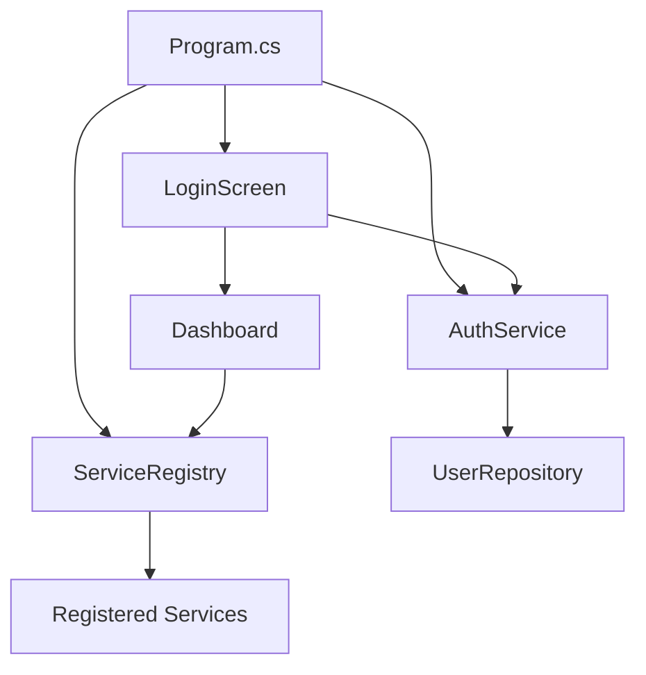

# Project Management System

A modular C# console application designed for user management, authentication, and service registration.

## 📂 Folder Architecture

```text
Project/
├── Data/               # Data access layer (in-memory repositories)
│   └── UserRepository.cs
├── Enums/              # Shared enumerations (Role, Status)
├── Models/             # Data transfer objects and entity models
│   ├── ServiceModule.cs
│   └── User.cs
├── Services/           # Business logic layer
│   ├── AuthService.cs      # Handles login and user session
│   ├── ServiceRegistry.cs  # Manages registration of system modules
│   └── WordService.cs      # Core business service logic
├── UI/                 # Presentation layer (Console-based UI)
│   ├── LoginScreen.cs      # User authentication UI
│   ├── Dashboard.cs        # Main application menu
│   ├── ConsoleHelper.cs    # Utilities for terminal formatting
│   └── ...                 # Feature-specific screens
├── Tests/              # Unit and integration tests
├── Program.cs          # Application entry point and configuration
└── Project.slnx        # Solution configuration
```

## 🏗 System Design

The application follows a **Modular Layered Architecture**:

1.  **Presentation Layer (UI)**: Handles user interaction through the console. Each screen is a separate component (e.g., `LoginScreen`, `Dashboard`).
2.  **Service Layer (Services)**: Contains the core business logic.
    -   `AuthService`: Manages user state and verifies credentials.
    -   `ServiceRegistry`: A central hub where functional modules (like `WordService`) are registered and checked for role-based access.
3.  **Data Layer (Data)**: Simplifies data access. Currently uses static in-memory collections via `UserRepository`.
4.  **Domain Models (Models/Enums)**: Defines the structure of data used across all layers.

### Flow Diagram



## 🔐 Authentication & Roles

The system implements Role-Based Access Control (RBAC):
-   **Root**: Full system access, including user management.
-   **Admin**: High-level access to system configurations.
-   **User**: Standard access to registered services like Word Count.

## 🚀 Getting Started

### Prerequisites
-   .NET 10.0 SDK

### Running the App
```bash
dotnet run
```

### Development Modes
-   `--dev`: Auto-logs in as Root.
-   `--user`: Auto-logs in as a standard User.

### Test Modes
The project uses xUnit for testing. Here's how to run the tests, including with watch mode:

-   `dotnet test Tests/`: Run all tests once
-   `dotnet watch test --project Tests/`: Run with watch mode (re-runs on file save):
-   `dotnet test Tests/ --filter "FullyQualifiedName~AuthServiceTests"`: Run a specific test file:
-   `dotnet test Tests/ --filter "FullyQualifiedName~AuthServiceTests.xMethodName" `: Run a specific test method:

The test files are in `Tests/Services/`:
- **AuthServiceTests.cs**
- **ServiceRegistryTests.cs**
- **WordServiceTests.cs**