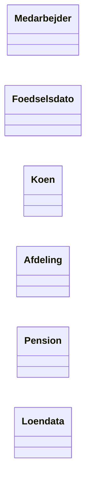
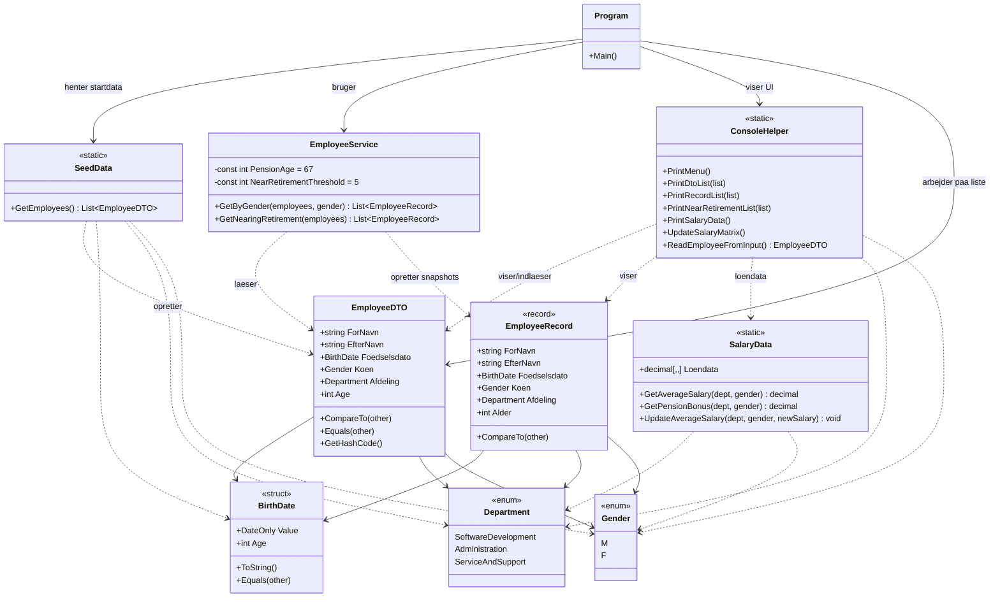
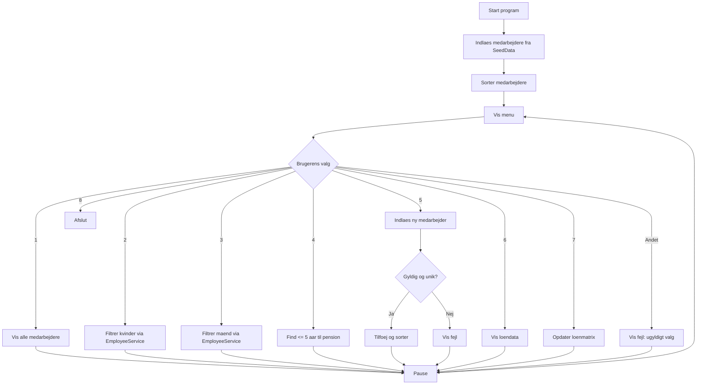

# Del 4: Diagrammer

Nedenfor er tre UML-relaterede diagrammer for projektet.

| Diagram | Viser | Fokus |
|---|---|---|
| Domain model | Begreber | Hvad er systemet? |
| Klassediagram | Struktur | Hvordan er det bygget? |
| Flowdiagram | Proces | Hvad sker der? |

## 1) Domain model

## 2) Klassediagram

## 3) Flowdiagram (menu/proces)

## Noter til aflevering

- Diagrammerne er skrevet i Mermaid og kan vises direkte i Markdown-viewer med Mermaid-support.
- Hvis du vil bruge Umletino, kan du genoptegne samme klasser/relationer manuelt ud fra ovenstående.
